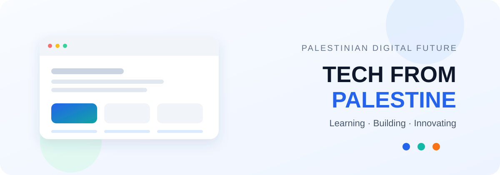

<!-- Animated project banner -->
<p align="center">
  
</p>

<h1 align="center">Tech From Palestine</h1>
<p align="center">
  <strong>A bilingual digital platform concept celebrating technology, learning, creativity, and community in Palestine.</strong>
</p>

<p align="center">
  
  
  
  
  
</p>

<p align="center">
  <a href="#overview">Overview</a> ·
  <a href="#features">Features</a> ·
  <a href="#pages">Pages</a> ·
  <a href="#tech-stack">Tech Stack</a> ·
  <a href="#getting-started">Getting Started</a>
</p>

---

## Overview

**Tech From Palestine** is a front-end website concept designed to present a Palestinian technology and learning community. It brings educational content, projects, community information, and contact options together in a modern, accessible, bilingual experience.

The interface is built with plain HTML, CSS, and JavaScript, with motion effects and subtle visual details to make browsing feel polished without overwhelming the content.

> This repository contains a front-end prototype. The contact form currently performs client-side validation and displays a confirmation state; it is not connected to a backend or message delivery service.

## Features

- **Arabic & English** — switch between RTL Arabic and LTR English content.
- **Multi-page navigation** — consistent navigation across the site's sections.
- **Responsive layout** — designed for desktop, tablet, and mobile screen sizes.
- **Course and project filtering** — filter cards by category.
- **Motion & interaction** — scroll reveal, animated counters, page loader, and ambient canvas effects.
- **Accessible interactions** — keyboard-friendly navigation, Escape-to-close mobile menu, ARIA states, and reduced-motion support.
- **Contact form validation** — field validation and feedback UI.
- **Reusable content data** — course, project, and category content organized in JavaScript data.

## Pages

| Page | Description |
| --- | --- |
| Home | Introduction, key highlights, and overview of the platform |
| About | Mission, vision, and platform identity |
| Courses | Learning opportunities and course categories |
| Projects | Community and technology projects |
| Community | Community participation and engagement |
| Contact | Contact form and validation feedback |

## Tech Stack

| Technology | Purpose |
| --- | --- |
| HTML5 | Semantic structure and page content |
| CSS3 | Layout, responsive styling, visual system, transitions |
| JavaScript (ES6+) | Navigation, language switching, filtering, validation, and UI behavior |
| GSAP | Timeline-based motion and animation |
| GSAP ScrollTrigger | Scroll-linked animation effects |
| Canvas API | Ambient background visuals |
| Intersection Observer | Reveal-on-scroll and counter activation |

## Project Structure

```text
my-project2/
├── assets/
│   └── readme-hero.svg
└── TechFromPalestine-minimal-motion/
    ├── css/
    │   └── style.css
    ├── js/
    │   ├── ambient-canvas.js
    │   ├── content.js
    │   └── site.js
    └── pages/
        ├── index.html
        ├── about.html
        ├── courses.html
        ├── projects.html
        ├── community.html
        └── contact.html
```

> The repository also contains a second `page/` directory with another copy of the website files. The structure above describes the `TechFromPalestine-minimal-motion/` version.

## Getting Started

No build tools or package installation are required.

### 1. Clone the repository

```bash
git clone https://github.com/Yousef-Osamm/my-project2.git
```

### 2. Open the project

Open the project folder in your editor, then open:

```text
TechFromPalestine-minimal-motion/pages/index.html
```

You can open the HTML file directly in your browser. For a smoother local development experience, use a simple local server or VS Code Live Server.

## Motion & Accessibility

The site uses motion to support the experience—not distract from it. Animations include reveal-on-scroll, number counters, ambient canvas visuals, and interface transitions.

The JavaScript checks the user's `prefers-reduced-motion` setting and avoids motion-heavy behavior when reduced motion is requested.

## Preview

The animated banner above is a custom README illustration—not a captured screenshot of the live website.

To add real project screenshots, create a `screenshots/` folder and place captures such as `home.png`, `courses.png`, and `projects.png` there. Then embed them here:

```md

```

## Future Improvements

- [ ] Add real desktop and mobile screenshots
- [ ] Connect the contact form to a backend or email service
- [ ] Publish a live demo
- [ ] Improve content management and course/project data workflows

## Author

**Yousef Osamm**

- GitHub: [@Yousef-Osamm](https://github.com/Yousef-Osamm)

---

<p align="center">
  Built with care, curiosity, and a vision for Palestinian technology.
</p>
